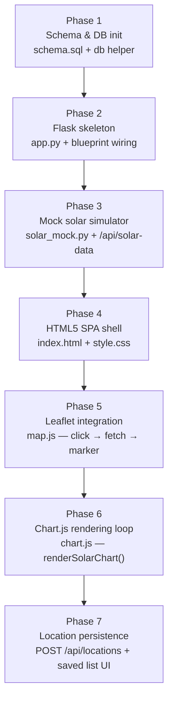

# EcoGrid: Community Solar Planner — Implementation Plan

> **Status:** Draft · v0.1 · 2026-10-17
> **Stack:** Python 3.11 · Flask · SQLite · HTML5 · Leaflet.js · Chart.js

---

## Table of Contents

1. [Project Overview](#1-project-overview)
2. [Directory Structure](#2-directory-structure)
3. [SQLite Database Schema](#3-sqlite-database-schema)
4. [Flask Server Structure](#4-flask-server-structure)
5. [Mock `/api/solar-data` Endpoint](#5-mock-apisolar-data-endpoint)
6. [HTML5 Single-Page Layout](#6-html5-single-page-layout)
7. [Dependencies](#7-dependencies)
8. [Implementation Phases](#8-implementation-phases)

---

## 1. Project Overview

EcoGrid is a browser-based community solar planning tool that lets users click any location on an interactive map to receive a simulated 12-month solar energy production estimate. Data is persisted locally in SQLite and served by a lightweight Flask API that mirrors the shape of the NREL PVWatts v8 response, enabling full local development without an API key.

---

## 2. Directory Structure

```
ecogrid-solar-planner/
├── implementation_plan.md      ← this file
├── requirements.txt            ← Python dependencies
├── app.py                      ← Flask entry point
├── database/
│   ├── schema.sql              ← DDL for SQLite tables
│   └── ecogrid.db              ← SQLite database (git-ignored)
├── api/
│   ├── __init__.py
│   ├── routes.py               ← Blueprint with /api/* endpoints
│   └── solar_mock.py           ← PVWatts payload simulator
├── static/
│   ├── css/
│   │   └── style.css
│   └── js/
│       ├── map.js              ← Leaflet initialisation & marker logic
│       └── chart.js            ← Chart.js rendering loop
└── templates/
    └── index.html              ← HTML5 SPA shell
```

---

## 3. SQLite Database Schema

### 3.1 Tables

#### `locations`
Stores a user-submitted coordinate with display metadata.

| Column         | Type         | Constraints              | Notes                                  |
|----------------|--------------|--------------------------|----------------------------------------|
| `id`           | INTEGER      | PRIMARY KEY AUTOINCREMENT | Surrogate key                         |
| `name`         | TEXT         | NOT NULL                 | User-supplied label (e.g. "My House") |
| `latitude`     | REAL         | NOT NULL                 | WGS-84 decimal degrees                |
| `longitude`    | REAL         | NOT NULL                 | WGS-84 decimal degrees                |
| `system_capacity_kw` | REAL  | NOT NULL DEFAULT 4.0     | Simulated panel capacity              |
| `created_at`   | TEXT         | NOT NULL DEFAULT (datetime('now')) | ISO-8601 timestamp      |

#### `solar_estimates`
Caches the simulated annual output per location so repeat queries are instant.

| Column               | Type    | Constraints                          | Notes                          |
|----------------------|---------|--------------------------------------|--------------------------------|
| `id`                 | INTEGER | PRIMARY KEY AUTOINCREMENT            |                                |
| `location_id`        | INTEGER | NOT NULL, FOREIGN KEY → locations.id | One-to-many                   |
| `annual_kwh`         | REAL    | NOT NULL                             | Sum of 12-month array          |
| `monthly_kwh`        | TEXT    | NOT NULL                             | JSON array, 12 values          |
| `ac_annual`          | REAL    | NOT NULL                             | Mirrors PVWatts `ac_annual`    |
| `solrad_annual`      | REAL    | NOT NULL                             | Avg daily irradiance (kWh/m²)  |
| `computed_at`        | TEXT    | NOT NULL DEFAULT (datetime('now'))   | When the estimate was run      |

### 3.2 DDL (`database/schema.sql`)

```sql
PRAGMA foreign_keys = ON;

CREATE TABLE IF NOT EXISTS locations (
    id                  INTEGER PRIMARY KEY AUTOINCREMENT,
    name                TEXT    NOT NULL,
    latitude            REAL    NOT NULL,
    longitude           REAL    NOT NULL,
    system_capacity_kw  REAL    NOT NULL DEFAULT 4.0,
    created_at          TEXT    NOT NULL DEFAULT (datetime('now'))
);

CREATE TABLE IF NOT EXISTS solar_estimates (
    id              INTEGER PRIMARY KEY AUTOINCREMENT,
    location_id     INTEGER NOT NULL
                        REFERENCES locations(id) ON DELETE CASCADE,
    annual_kwh      REAL    NOT NULL,
    monthly_kwh     TEXT    NOT NULL,   -- JSON array: [jan, feb, ..., dec]
    ac_annual       REAL    NOT NULL,
    solrad_annual   REAL    NOT NULL,
    computed_at     TEXT    NOT NULL DEFAULT (datetime('now'))
);

CREATE INDEX IF NOT EXISTS idx_estimates_location
    ON solar_estimates(location_id);
```

---

## 4. Flask Server Structure

### 4.1 `app.py` — Entry Point

```
Responsibilities:
  - Create / connect to SQLite (apply schema.sql on first run)
  - Register the `api` Blueprint
  - Serve index.html via a catch-all route (SPA pattern)
  - Run with debug=True on port 5000 during development
```

### 4.2 `api/routes.py` — Blueprint

| Method | Path                     | Description                                                  |
|--------|--------------------------|--------------------------------------------------------------|
| GET    | `/api/solar-data`        | Return mock PVWatts payload for given lat/lon                |
| POST   | `/api/locations`         | Persist a new location + trigger estimate computation        |
| GET    | `/api/locations`         | List all saved locations with their latest estimate          |
| DELETE | `/api/locations/<id>`    | Remove a location and its cascaded estimates                 |

### 4.3 `api/solar_mock.py` — Simulator

```
Responsibilities:
  - Accept (lat, lon, system_capacity_kw)
  - Derive a latitude-based irradiance factor (higher latitude → lower output)
  - Apply a sinusoidal seasonal curve across 12 months (peak in summer)
  - Add ±5% random noise per month to simulate real-world variation
  - Return a dict that mirrors the PVWatts v8 JSON shape (see §5 below)
```

---

## 5. Mock `/api/solar-data` Endpoint

### 5.1 Query Parameters

| Param              | Type  | Required | Default | Description                       |
|--------------------|-------|----------|---------|-----------------------------------|
| `lat`              | float | ✅       | —       | Latitude (WGS-84)                |
| `lon`              | float | ✅       | —       | Longitude (WGS-84)               |
| `system_capacity`  | float | ❌       | 4.0     | DC system size in kW             |
| `losses`           | float | ❌       | 14.0    | System losses in %               |

### 5.2 Response Shape (mirrors PVWatts v8)

```json
{
  "inputs": {
    "lat": 40.01,
    "lon": -105.27,
    "system_capacity": 4.0,
    "losses": 14.0,
    "array_type": 1,
    "module_type": 0,
    "tilt": 20,
    "azimuth": 180
  },
  "errors": [],
  "warnings": [],
  "outputs": {
    "ac_monthly":     [320, 370, 480, 510, 560, 590, 580, 560, 500, 430, 330, 290],
    "dc_monthly":     [335, 388, 503, 535, 587, 619, 608, 587, 524, 451, 346, 304],
    "poa_monthly":    [82,  105, 155, 172, 195, 208, 204, 192, 162, 128, 84,  71],
    "solrad_monthly": [2.64, 3.75, 5.0, 5.73, 6.29, 6.93, 6.58, 6.2, 5.41, 4.13, 2.8, 2.29],
    "ac_annual":      4520.0,
    "solrad_annual":  4.94,
    "capacity_factor": 12.9
  },
  "_meta": {
    "source": "ecogrid-mock",
    "note": "Simulated data. Not from NREL PVWatts."
  }
}
```

> [!NOTE]
> All numeric values in the mock are derived algorithmically from `lat` and `system_capacity` — not hard-coded — so different coordinates produce meaningfully different outputs, making testing realistic.

### 5.3 Simulation Algorithm

```
base_irradiance  = 5.5 - 0.035 * |lat|          (kWh/m²/day at equinox)
seasonal_curve   = [cos((month - 7) * π / 6) for month in 1..12]
  adjusted for southern hemisphere if lat < 0
poa_monthly[m]   = base_irradiance * (1 + 0.4 * seasonal_curve[m]) * 30
ac_monthly[m]    = poa_monthly[m] * system_capacity * efficiency * noise_factor
efficiency       = (1 - losses/100) * 0.96     (≈ panel efficiency)
noise_factor     = uniform(0.95, 1.05)
```

---

## 6. HTML5 Single-Page Layout

### 6.1 `templates/index.html` — Structure

```
<html>
└── <head>
    ├── <meta charset, viewport>
    ├── <title>EcoGrid · Community Solar Planner</title>
    ├── Leaflet CSS  (CDN: unpkg.com/leaflet@1.9/dist/leaflet.css)
    ├── Chart.js     (CDN: cdn.jsdelivr.net/npm/chart.js@4)
    └── style.css    (local)

└── <body>
    ├── <header>      — Logo + nav links
    ├── <main>
    │   ├── #map-panel
    │   │   └── <div id="map">   ← Leaflet mounts here (height: 60vh)
    │   └── #data-panel
    │       ├── #location-info   ← Selected lat/lon + name input
    │       ├── #chart-container
    │       │   └── <canvas id="solar-chart">  ← Chart.js mounts here
    │       ├── #annual-summary  ← kWh total badge
    │       └── #saved-locations ← List of persisted pins
    └── <footer>
        └── Data disclaimer (simulated, not NREL)

    ├── Leaflet JS   (CDN)
    ├── map.js       (local — deferred)
    └── chart.js     (local — deferred)
```

### 6.2 Leaflet (`static/js/map.js`) Responsibilities

- Initialise map centred on continental US (lat 39, lon −98, zoom 4)
- On map click → extract `latlng` → call `/api/solar-data?lat=…&lon=…`
- Drop a marker at clicked point; bind popup with annual kWh summary
- On successful API response → pass `outputs.ac_monthly` to Chart.js module
- On "Save Location" button → `POST /api/locations` with name + coords

### 6.3 Chart.js (`static/js/chart.js`) Responsibilities

- Export a `renderSolarChart(monthlyData, locationName)` function
- Render a **vertical bar chart** (type: `'bar'`)
  - X-axis: Jan – Dec labels
  - Y-axis: kWh output, starting at 0
  - Tooltip: shows exact kWh value on hover
- Re-render (destroy + recreate) each time a new map location is clicked
- Color scheme: amber gradient `#f59e0b` → `#f97316` (solar palette)

---

## 7. Dependencies

### Python (`requirements.txt`)

```
flask>=3.0
flask-cors>=4.0      # Allow JS fetch from same origin during dev
```

> [!TIP]
> No ORM is needed — raw `sqlite3` from the stdlib keeps the stack minimal and educational.

### JavaScript (CDN — no build step)

| Library   | Version | CDN                                          |
|-----------|---------|----------------------------------------------|
| Leaflet   | 1.9.x   | `unpkg.com/leaflet@1.9/dist/`               |
| Chart.js  | 4.x     | `cdn.jsdelivr.net/npm/chart.js@4`            |

---

## 8. Implementation Phases



| Phase | Deliverables                                        | Estimated LOC |
|-------|-----------------------------------------------------|---------------|
| 1     | `database/schema.sql`, db init helper in `app.py`   | ~30           |
| 2     | `app.py`, `api/__init__.py`, `api/routes.py`        | ~60           |
| 3     | `api/solar_mock.py`, GET `/api/solar-data`          | ~70           |
| 4     | `templates/index.html`, `static/css/style.css`      | ~80           |
| 5     | `static/js/map.js`                                  | ~90           |
| 6     | `static/js/chart.js`                                | ~60           |
| 7     | POST/GET/DELETE `/api/locations`, saved-list JS     | ~80           |

**Total estimated:** ~470 lines across 10 files.

---

> [!IMPORTANT]
> All solar output values are **simulated** and must not be presented to end-users as real NREL data. A disclaimer is included in both the UI footer and every API response via the `_meta.note` field.
